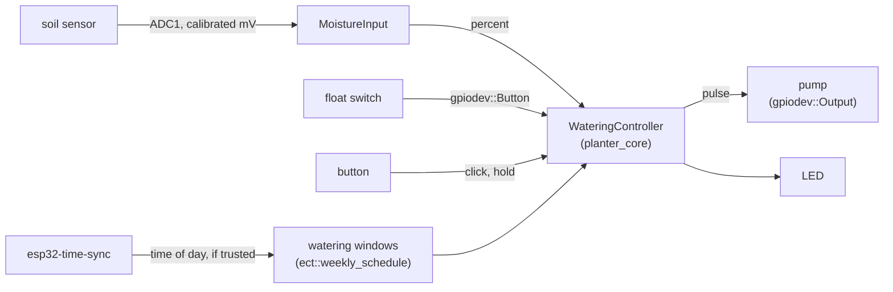
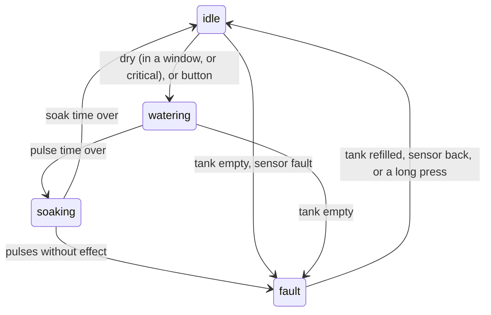

# esp32-smart-planter

[](https://github.com/PATEmbedded/esp32-smart-planter/actions/workflows/ci.yml)
[](LICENSE)

ESP-IDF firmware for a self-watering plant pot. It measures the soil, waters in short pulses at the times you allow, and stops when something is wrong: an empty tank, a loose hose or a broken sensor.

The firmware is built from three of my libraries: [esp32-gpio-devices](https://github.com/PATEmbedded/esp32-gpio-devices) for the button, the tank switch, the pump and the LED, [esp32-time-sync](https://github.com/PATEmbedded/esp32-time-sync) for the clock, and [embedded-cpp-toolkit](https://github.com/PATEmbedded/embedded-cpp-toolkit) for the state machine and the watering windows. The watering logic has no hardware access, so the tests run it on a PC against a simulated pot for days at a time.

## What it does

- **Measures** soil moisture with a capacitive sensor: two-point calibration, the median of nine readings, and a sensor fault for readings far outside the calibrated range, such as a broken wire.
- **Waters in pulses**: a few seconds of pumping, then a soak time so the water spreads before the next reading. A cycle starts below 35 % and ends at 55 %.
- **Keeps to watering windows**, 06:00 to 09:00 and 18:00 to 21:00 local time by default. Soil below 15 % is watered at any time.
- **Knows when it does not know the time**: before the clock is set from a time server, or without Wi-Fi at all, it waters only critically dry soil.
- **Stops when something is wrong**:
  - a float switch reports an empty tank: the pump stops at once
  - more than a daily budget of pump time, 60 s per 24 hours by default
  - four pulses in a row that do not raise the reading, as with a loose hose or a dry pump: a fault that only a person can clear, because the water may be going somewhere else
- **Cannot leave the pump on**: the pump output times each pulse itself, so the pump stops even if the control task stops. The task watchdog resets the chip if the task hangs, and a pull-down on the MOSFET gate keeps the pump off during the reset.
- **Button**: a click gives one pulse now; holding it for three seconds clears a fault. The LED is on while watering, blinks slowly while the water soaks in, and blinks fast on a fault.

## How it fits together



The controller is an `ect::state_machine` with four states. Pulse and soak times are its state timeouts.



## Hardware

| Part | Notes |
|---|---|
| ESP32, ESP32-S3 or ESP32-C3 board | CI builds for all three |
| Capacitive soil-moisture sensor with an analog output | powered from 3.3 V; on an ADC1 pin, because Wi-Fi blocks ADC2 on the ESP32 |
| Small DC pump and tank | 5 V or what the pump needs, with its own supply rail |
| Logic-level N-channel MOSFET | gate through about 100 Ω from the pump pin, 100 kΩ from gate to GND, a diode across the pump |
| Float switch (optional) | to GND, closed when the tank is empty |
| Push button and LED | the board's BOOT button and LED work |

| Signal | ESP32 | ESP32-S3 | ESP32-C3 |
|---|---|---|---|
| Soil sensor | GPIO34 | GPIO4 | GPIO3 |
| Pump | GPIO25 | GPIO5 | GPIO5 |
| Float switch | GPIO26 | GPIO6 | GPIO6 |
| Button | GPIO0 | GPIO0 | GPIO9 |
| LED | GPIO2 | GPIO2 | GPIO10 |

All pins, thresholds, times, windows, the Wi-Fi network and the time zone are set in menuconfig under *Smart planter*.

## Building and flashing

```sh
cd firmware
idf.py set-target esp32      # or esp32s3, esp32c3
idf.py menuconfig            # Smart planter: Wi-Fi, pins, calibration
idf.py build flash monitor
```

The three libraries are git submodules in [firmware/components](firmware/components), pinned to their v1.0.0 releases, so clone with `git clone --recursive`, or run `git submodule update --init` in an existing clone. ESP-IDF 5.0 or newer is needed.

## Calibrating the sensor

Sensors differ, so the default calibration is only a starting point. The firmware logs the raw voltage every minute:

```
I (61234) planter: 2026-10-19T07:12:00+02:00 soil 41.3 % (1981 mV), tank ok, window open, idle, pump 0 s, clock synced
```

1. Hold the sensor in dry air and note the millivolts: that is *Sensor output in dry air*.
2. Put the probe in a glass of water up to its line and note the millivolts again: *Sensor output with the probe in water*.
3. Set both in menuconfig under *Smart planter → Sensor calibration*.

## Tests

The watering logic in [firmware/components/planter_core](firmware/components/planter_core) builds on a PC against the same toolkit submodule, and the tests run with AddressSanitizer and UBSan under GCC and Clang:

- the sensor mapping, its fault detection and the median filter
- watering windows, also across midnight, and an unknown time of day
- the controller: pulses, windows, critical dryness, no clock, an empty tank during a pulse, pulses without effect, the daily budget, manual pulses and sensor faults
- a simulated pot that dries out by the hour: a week with the soil kept between the thresholds, no pumping outside the windows and the budget kept; a loose hose that ends in a fault after four pulses, and a recovery that the budget spreads over two days; an empty tank that stops the pump until it is refilled

CI also builds the firmware with ESP-IDF 5.5 and 6.0 for ESP32, ESP32-S3 and ESP32-C3.

```sh
cmake -S . -B build -DPLANTER_SANITIZE=ON
cmake --build build
ctest --test-dir build --output-on-failure
```

## Status

The firmware builds and its logic is tested, but it has not run on a real pot yet. The thresholds, times and calibration are defaults to start from, not measured values.

## License

MIT. See [LICENSE](LICENSE).
